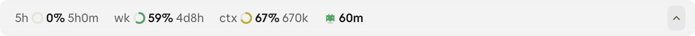
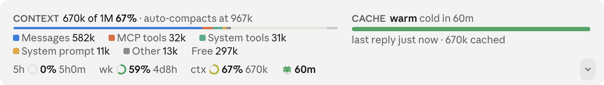

# Claude Code Usage Band

A slim band above the prompt in the Claude Code desktop app: your 5-hour and weekly limits, context and prompt cache at a glance.

<picture>
  <source media="(prefers-color-scheme: dark)" srcset="docs/row-dark.png">
  
</picture>

Each ring fills from green to red as it's used, with the time until it resets beside it. The robot is the prompt cache: green while warm, orange and red as it runs out, blue once cold. The chevron opens the context breakdown.

<picture>
  <source media="(prefers-color-scheme: dark)" srcset="docs/band-dark.png">
  
</picture>

## Install

```
/plugin install usage-band --marketplace crlandsc/claude-code-usage-band
```

Or clone it anywhere and add the folder to `CLAUDE_CODE_PLUGIN_DIRS`. It follows the app's light or dark mode, and the terminal gets a one-line text version.

MIT licence. The cache countdown was inspired by [ribbon](https://github.com/robonuggets/ribbon).
